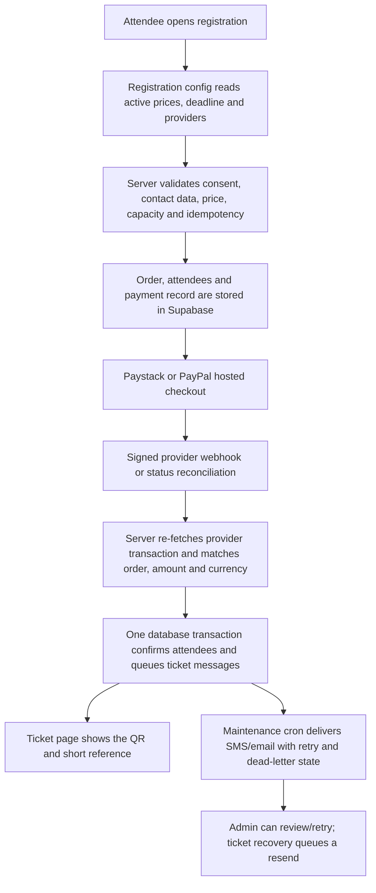
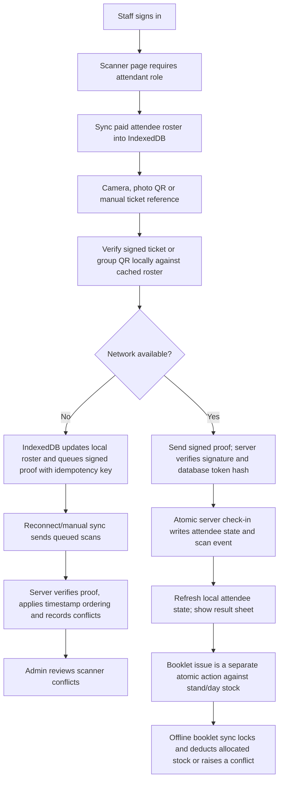
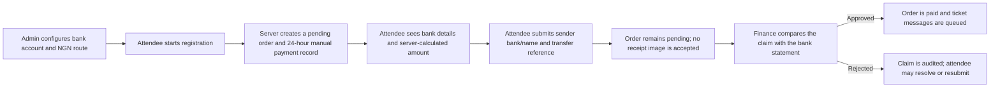

# IHGC 2026 project flow and remaining phases

This document separates flows already implemented in the repository from operational steps that still need Supabase, provider, organizer, or event-day verification. It treats the 404 and receipt-scanner screenshots as visual references; their placeholder copy and payment actions are not product requirements.

## Current registration and ticket flow

Registration settings are loaded from the server, and the browser does not set the amount. Live provider keys, a real end-to-end payment and settlement check, and Supabase migrations remain deployment gates.

## Current scanner flow

The scanner provides online check-in, offline queuing, signed group-order check-in, roster refresh, status indicators, photo QR selection, flashlight support where available, and recovery messages. Booklet issues are limited by an atomic stand/day stock ledger. A multi-staff rehearsal is still needed to verify timing, camera behavior, inventory handover, and offline conflict handling on the actual devices.

## Current manual-transfer flow

The bank account information must be supplied and configured by the organizer. Submitting transfer details never confirms payment.

## Flow after launch gates are cleared

```mermaid
flowchart LR
  A[Owner supplies approved copy, bank details, venue pin and event operations data] --> B[Apply migrations to Supabase and verify RLS / server-role access]
  B --> C[Configure production secrets, Turnstile, Redis, cron, backups and alerts]
  C --> D[Run low-value Paystack and PayPal payments through settlement]
  D --> E[Run security, accessibility, load, offline-sync and restore checks]
  E --> F[Rehearse with 10 staff and 300 test tickets]
  F --> G[Freeze configuration and print protected Plan B attendee list]
  G --> H[Open public registration with monitoring and support process]
  H --> I[Conference-day check-in, booklet issue, walk-ins and finance reconciliation]
  I --> J[Archive/retain data under owner-approved policy and close out event]
```

The final event-day flow includes human approval and physical controls. A code change cannot perform the live settlement, backup restore, volunteer rehearsal, print security, or venue check.

## Phase status

| Phase | Repository status | Remaining work |
|---|---|---|
| 0 — foundation | Mostly complete | Check-in with the chosen deployment host; gather 1440/768/390 reference captures; confirm migrations and CI in the release environment. |
| 1 — registration launch | Code mostly present; public launch gates remain | Apply Supabase migrations; configure production provider credentials/webhooks and test settlement; confirm Paystack currency support; provide bank transfer details and finish its submission path; enable/restore-test backups and configure alerts; approve public legal/content copy. |
| 2 — on-site operations | Partial; scanner online and offline paths are implemented | Build staff/role and device administration/revocation, stock allocation and enforcement, searchable audit UI, per-stand reporting, programme editing/import, substitution process, and complete manual-transfer submission/approval operations. Supply stand assignments and booklet quantities. |
| 3 — security and resilience QA | Static/unit review complete in part; operational validation outstanding | External penetration test; end-to-end/race/PayPal pending/forged QR tests; mobile accessibility audit; 500–1,000 concurrent-registration load test; offline conflict and dead-device chaos tests; 300-ticket volunteer rehearsal; tested Supabase restore; production monitoring/alerts. |
| 4 — freeze and rehearsal | Not started | Owner-approved freeze, final live rehearsal, secure Plan B list and procedure, event-day checklist, roles and escalation contacts. |

## Owner-supplied items

See [CONTENT_REQUESTS.md](./CONTENT_REQUESTS.md). The remaining photo request is a second, high-resolution Evang. Linda Paul Rika portrait for the Ministers page. Camp Info needs a confirmed map pin and directions, which are location data rather than a missing photo. Approved ministry copy/bios/theme exposition, legal/privacy text and contact, bank details, Paystack currency confirmation, and stand/booklet setup are also outstanding.
